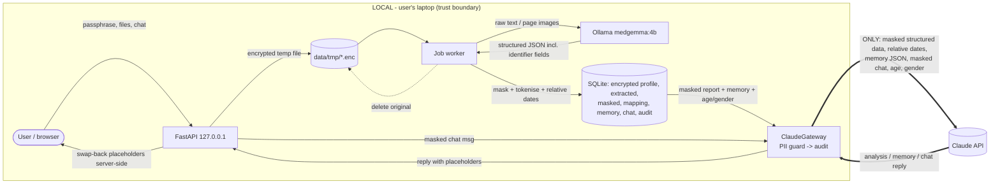

# Design

## Context

Greenfield repository. Motivation and scope are in `proposal.md`, the requirements are in `specs/*/spec.md`, and the rationale and alternatives behind each choice are in `/decisions.md` (D1–D13). The design team's raw positions are in `docs/design-team/`.

Target machine: a single laptop with 4 CPU cores, 15 GB RAM and no GPU, running Python 3.12 and `uv`. Ollama serves `medgemma:4b` (Q4_K_M, 3.3 GB, text and vision) on `127.0.0.1:11434`. Expect roughly 1–3 minutes per page on CPU; the spike (D12) will measure it.

## Goals / Non-Goals

**Goals:**
- One process, one SQLite file, one worker thread, one exit point to Claude, so a reviewer can trace every byte that leaves the machine.
- Plain functions, with only three small interfaces: `LocalLLMClient`, `ClaudeGateway` and `PIIGuard`.
- Everything installs with `uv` from prebuilt wheels on Linux, macOS and Windows. No system libraries.

**Non-Goals:**
- Horizontal scale, multiple users, high availability, streaming responses.
- Defending against malware already running as the same OS user (recorded as a residual risk).
- Clinical-grade extraction accuracy. The read-only review step makes errors visible instead.

---

## HLD — High-level design

### Components

| Component | Responsibility | Trust zone |
|---|---|---|
| **Thin client** (`frontend/`, HTML/CSS/jQuery) | Screens: register/login, upload and status, review, analysis, memory, chat, Privacy log, delete. Calls the REST API only; renders text escaped. | Local |
| **API** (FastAPI on `127.0.0.1:8000`, also serves `frontend/` as static files) | Auth and sessions, upload validation, job endpoints, analysis, chat, audit views. | Local |
| **Job worker** (one daemon thread) | Runs file jobs (extract, mask, store) and analysis jobs in order. | Local |
| **Agent 1: Extractor and Masker** | Parses PDF, image or Excel input; MedGemma structures it into a JSON schema; rules-based masking and tokenisation. | Local |
| **Local LLM** (Ollama, `medgemma:4b`) | Structured extraction (text and vision), accessed only via `LocalLLMClient`. | Local |
| **Store** (SQLite, `data/app.db`, plus `data/tmp/*.enc`) | Every sensitive value is AES-256-GCM encrypted under the user's data key (DEK). | Local |
| **PII Guard** | Final-payload scan (known values exact and fuzzy, plus regex patterns); fails closed. | Local |
| **ClaudeGateway** | The only module that imports `anthropic`. Runs guard, then audit, then send. | Local → **Claude** |
| **Agent 2: Analyst and memory** | Batch analysis and memory rewrite (`claude-sonnet-5-5`). | via Gateway |
| **Chat bot** | Context assembly, chat guard flow, fold of old turns (`claude-haiku-5-5`). | via Gateway |

### Data-flow diagram (what stays local vs what goes to Claude)



**Never leaves the machine:** name, the passphrase or any key, raw files, unmasked extracted data, the token mapping, real dates, free-text narrative, lab, hospital and doctor names, IDs, contact details.

---

## LLD — Low-level design

### Repo layout

```
backend/
  pyproject.toml              # uv; deps below
  app/
    main.py                   # app, lifespan (DB init, temp sweep, worker start), TrustedHost, StaticFiles(frontend)
    config.py                 # env: OLLAMA_URL, LOCAL_MODEL, CLAUDE_ANALYSIS_MODEL, CLAUDE_FOLD_MODEL, DATA_DIR, limits
    db.py                     # sqlite3, DDL, secure_delete=ON, small helpers (no ORM)
    crypto.py                 # Argon2id KEK, DEK wrap/unwrap, enc(obj, aad)/dec(blob, aad)
    sessions.py               # token -> {dek, expires, idle}, worker lease, login back-off
    api/  auth.py uploads.py jobs.py review.py analysis.py memory.py chat.py audit.py profile.py
    llm/  local.py            # LocalLLMClient protocol, OllamaClient, OpenAICompatClient (Phase-2 stub, TLS-only)
          claude.py           # ClaudeGateway
    pipeline/ ingest.py       # bytes -> text | page PNGs | rows (pypdfium2, Pillow, openpyxl, csv)
              extract.py      # MedGemma prompt + JSON schema, plausibility flags
              mask.py         # tokenise identifiers, relative dates, known-value/regex scan
              worker.py       # single thread, job state machine, restart recovery
    guard.py                  # PIIGuard.scan(payload, profile_ctx) -> Hits; chat auto-mask / needs_confirm
    memory.py                 # schema, cap enforcement, update, rollback copy, fold
    prompts/*.txt             # extract, analyse, memory, chat, fold
frontend/  index.html  app.js  style.css  vendor/jquery-3.7.1.min.js
scripts/   qa_*.sh (curl), qa_leak_probe.sh, make_canary_samples.py
data/      (gitignored runtime)
```

**Dependencies:** fastapi, uvicorn, python-multipart, anthropic, httpx (Ollama calls), pypdfium2, Pillow, openpyxl, cryptography, argon2-cffi, rapidfuzz. No ORM, no LangChain.

### Data model (`enc` = AES-GCM blob, AAD = `table|row_id`)

| Table | Plaintext columns | Encrypted (`enc_blob` JSON) |
|---|---|---|
| `profile` (one row) | id, kdf_salt, kdf_params, wrapped_dek, anchor_set, created_at | name, age, gender, date_anchor |
| `batches` | id, created_at, analysed (bool) | — |
| `jobs` | id, batch_id, type (`file`/`analysis`), mime, status, attempts, error_code, created_at, updated_at | file_name |
| `extracted` | id, job_id, created_at | full structured record incl. identifier fields, real dates, flags |
| `masked_reports` | id, job_id, created_at | masked structured record (sendable form) |
| `pii_mapping` | id, token | kind, real_value, normalised forms for the fuzzy match |
| `analyses` | id, batch_id, model, created_at | result (masked; swapped back on read) |
| `memory` | version, updated_at | current JSON, previous JSON |
| `chat_messages` | id, role, folded, created_at | masked content, guard notes |
| `audit_log` | id, ts, purpose, decision, model, payload_sha256 | masked payload, rule_ids |

### REST API (bearer token in `Authorization`, except register and login)

| Method & path | Purpose |
|---|---|
| `POST /api/register` `{name, age, gender, passphrase, ack_no_recovery}` | 201 + token; 409 if a profile exists |
| `POST /api/login` `{passphrase}` / `POST /api/logout` | session start and end |
| `POST /api/uploads` (multipart `files[]`) | 202 `{batch_id, jobs[], rejected[]}` |
| `GET /api/batches/{id}` · `GET /api/jobs?ids=` | status polling (does not reset the idle timer) |
| `GET /api/batches/{id}/review` | read-only extracted values, real dates, flags, mismatch warning |
| `POST /api/batches/{id}/analyse` | 202 `{job_id}` (analysis job) |
| `GET /api/analyses/latest` · `GET /api/analyses/{id}` | analysis, swapped back on the server, plus the disclaimer |
| `POST /api/analyses/{job_id}/retry` `{mask_spans}` | after `blocked_pii` |
| `GET /api/memory` | current memory (swapped back) |
| `POST /api/chat` `{message, confirm_mask?}` | 200 `{reply, sent_masked, hidden[]}` · 422 `{needs_confirm, hits[{kind,start,end}]}` · 503 guard error |
| `GET /api/chat/history` | swapped-back turns plus the "Sent to Claude" text |
| `GET /api/audit` | Privacy log entries with their masked payloads |
| `DELETE /api/profile` `{passphrase}` | delete everything |

### Key interfaces

```python
class LocalLLMClient(Protocol):
    def generate(self, prompt: str, images: list[bytes] = (), json_schema: dict | None = None) -> dict: ...
# OllamaClient: POST /api/chat, model=medgemma:4b, format=<schema>, temperature=0, num_ctx=8192

class ClaudeGateway:
    def send(self, purpose: str, system: list[dict], messages: list[dict], model: str) -> str:
        # payload = serialise(system, messages); hits = guard.scan(payload)  -> raise Blocked (audited)
        # audit.write(purpose, 'sent', sha256, enc(payload)); return sdk.messages.create(...)
```

### Processing pipeline (file job)
1. **Upload:** reject requests whose `Content-Length` or streamed body is over 105 MB before parsing; check magic bytes, size and the XLSX zip and macro rules; read the file into memory (`MultiPartParser.spool_max_size` is raised above the request cap so nothing touches the OS temp folder); then encrypt it to `data/tmp/<uuid>.enc` with mode 0600 and enqueue it.
2. **`extracting`:** decrypt into memory and route by type:
   - text PDF: pypdfium2 extracts the text;
   - scanned PDF or image: pypdfium2 or Pillow produces PNGs at ≤1600 px for MedGemma vision;
   - XLSX or CSV: openpyxl or csv reads the rows.
   MedGemma then returns JSON matching the extraction schema: identifier fields plus `tests[]` or `measurements[]`.
3. **`masking`:**
   - identifier fields are tokenised into the mapping and dropped from the masked record;
   - dates become `T0±Nd`, with the anchor set from the first report date;
   - every sendable string goes through the known-value (rapidfuzz) and regex scan;
   - narrative is dropped.
4. **Store:** write `extracted` and `masked_reports` (encrypted), delete the temp file, and set the job to `done`.

### Analysis job
Masked reports from the batch, the memory JSON, age (or `90+`) and gender are sent through the Gateway to `claude-sonnet-5-5`. The system prompt and memory are a cached prefix. The response carries the analysis plus a proposed new memory JSON. The memory is validated against its schema, capped and guard-scanned, then stored with a rollback copy, and the analysis is stored.

### Chat turn
1. `guard.chat_prepare(msg)` auto-masks known values. Unknown pattern hits return `422 needs_confirm`; `confirm_mask` tokenises them.
2. The context is built: system prompt and memory (cached), the latest masked report, the last 6 turns and the new message.
3. The Gateway sends it.
4. Placeholders in the reply are swapped back on the server, and the turn is stored masked.
5. If there are more than 12 unfolded turns, a fold job sends the oldest 6 plus memory to `claude-haiku-5-5` through the Gateway.

### Sessions and keys
- **Registration:** the DEK is 32 random bytes. The KEK is Argon2id(passphrase, salt; m=64 MiB, t=3, p=2), and `wrapped_dek = AESGCM(KEK).encrypt(DEK)`.
- **Login:** a successful unwrap is the passphrase check.
- **Sessions:** `sessions[sha256(token)] = {dek: bytearray, last_user_req, issued}`. A token is valid for 15 minutes idle and 8 hours absolute.
- **Worker lease:** while unfinished jobs exist, the worker holds a reference to the DEK until it is idle or the 8-hour cap is reached. Logout drops both the token and the lease.

### Job state machine
```
file:     queued -> extracting -> masking -> done        | failed (attempts>2, unsupported, 24h without unlock)
          (any non-terminal) -> waiting_for_unlock -> queued   (on login)
analysis: queued -> analysing -> done | blocked_pii | failed
startup:  non-terminal -> queued (attempts+1); sweep orphan temps
```

---

## Decisions

Summary only; the full alternatives are in `/decisions.md`.

- **Plain Python and the Anthropic SDK over LangGraph or Deep Agents (D2).** Fixed linear pipelines, one visible exit point, simple stack traces.
- **Job table and one worker thread over Redis+RQ or BackgroundTasks (D3).** MedGemma on CPU can't run in parallel anyway. Redis adds a process and puts state outside our encryption. BackgroundTasks has no restart recovery.
- **App-level AES-GCM over SQLCipher (D8).** `sqlcipher3-binary` ships Linux x86_64 wheels only. The cost is that some metadata stays in plaintext.
- **Masking pipeline: identifier fields in the extraction schema, then rules, then a fail-closed guard (D4).** A second MedGemma scrub pass was rejected because it doubles CPU time. Free text is excluded from what is sent.
- **Day offsets for dates (D5).** They keep the intervals that trends need. Opaque date tokens and month/year forms were rejected.
- **Structured memory JSON, fully rewritten, about 1,500 tokens (D6).** It stays bounded, and the fixed fields stop quasi-identifiers from creeping in.
- **Bearer token and same-origin static client (D9).** No cookies, no CSRF exposure, no CORS to configure.
- **Placeholder swap-back on the server (D4).** The browser never holds the mapping.

## Risks / Trade-offs

- [MedGemma 4B misreads scanned digits on CPU] → route text PDFs through text extraction; flag vision-route values "check this"; read-only review before analysis; measure in the spike (D12).
- [Processing is slow: minutes per page] → 10 pages per PDF, one worker, the worker lease, and clear progress states.
- [Masking misses an unusual identifier] → structured-only data sent out, fail-closed guard on every payload, canary leak probe, Privacy log for human review.
- [Re-identification from rare values plus age and gender] → `90+` band, rare panels flagged; recorded as a residual risk.
- [Claude writes quasi-identifiers into memory] → fixed schema, guard scan before storing, rollback copy.
- [DEK can't be zeroised in Python memory; swap file] → accepted for the POC; README recommends full-disk encryption.
- [Metadata (timestamps, counts, file type) is plaintext] → accepted; no health or personal values in plaintext columns.
- [Anthropic retains API data for 30 days by default] → only masked data is sent; noted in the README; zero data retention can be requested in Phase 2.
- [Forgotten passphrase means total data loss] → explicit acknowledgement at registration; by design.
- [Prompt cache below the 512-token minimum for new users] → no harm; check `cache_read_input_tokens` in QA.

## Phase-2 seam: company vLLM server (not built)

`OpenAICompatClient` implements `LocalLLMClient` with config only. Only `127.0.0.1`, `::1` and `localhost` count as local; any other host must use `https://`, and TLS verification can never be disabled. Because this server sees **unmasked** files, it sits inside the trust boundary. Requirements (D11):
- TLS;
- API key or mTLS;
- private network or VPN (an IP allowlist alone is not enough);
- no prompt logging;
- disk encryption;
- files deleted after processing;
- no shared cloud GPU without a data processing agreement.

## Security review

`security-review.md` (verdict: approve with fixes, F1–F15). All fixes have been folded into the specs and tasks, and are tagged `SEC Fn` in tasks.md.

## Migration Plan

Greenfield, so nothing to migrate. Rollback means deleting `data/`. The setup steps (uv, Ollama, `ollama pull medgemma:4b`, `.env` with the API key) go in the README.

## Open Questions

- MedGemma's measured accuracy and latency per input type, and the minimum hardware (D12). The spike runs when the sample files arrive; the results tune the flags and limits but do not change the specs.
- Confirm that the Starlette `MultiPartParser.spool_max_size` attribute exists in the pinned version. If not, fall back to `TMPDIR=/dev/shm` on Linux.
